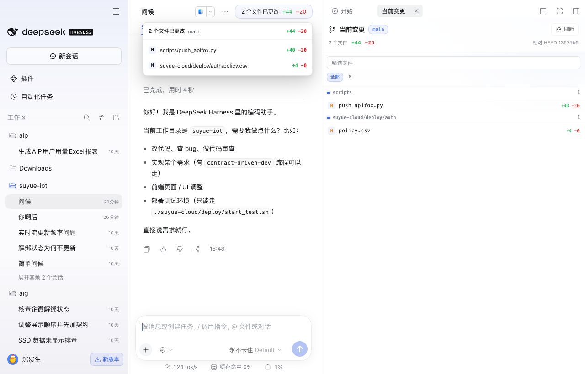
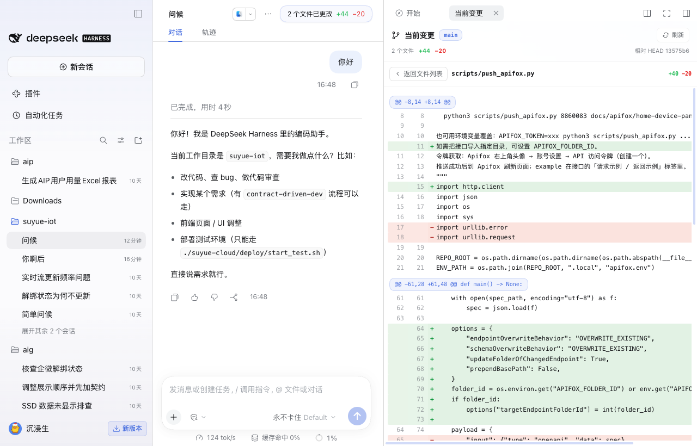

# Working Changes for DeepSeek Harness

[English](#english) | [中文](#中文)

[](https://github.com/topics/dsh-plugin)
[](https://github.com/xuex991/dsh-working-changes/releases)
[](LICENSE)

A small, read-only DSH plugin that shows what the current session has changed.
It is the working tree relative to `HEAD`: the same practical scope as
`git status`, without staging, committing, or branch management.





## English

### Features

- Shows `branch · changed files · +insertions −deletions` in the session header.
- Hovering the summary lists changed files with per-file line counts.
- Clicking the summary or a file opens the native DSH right sidebar.
- Renders unified diffs with line numbers and platform diff colors.
- Supports file filtering, status badges, renames, binary files, and refresh.
- Refreshes after an Agent turn, on window focus, and on demand.
- Read-only: no stage, commit, branch, stash, push, pull, or worktree actions.

### Install

#### DSH Plugins UI

1. Open **Plugins** in DSH.
2. Choose **Add plugin**.
3. Enter `https://github.com/xuex991/dsh-working-changes`.
4. Install and enable **Working Changes**.

#### Plugin market index

In **Plugins → Discover → Index sources**, add:

```text
https://xuex991.github.io/dsh-working-changes/index.json
```

Then open **Working Changes** from the discovery page.

### Requirements

- DeepSeek Harness `0.2.1-rc.2` or newer.
- `git` available in the DSH host environment.

### Limits

- The current worktree is compared with `HEAD`; staged and unstaged states are
  intentionally combined.
- Binary files are listed but not rendered as text.
- One diff is capped at 400,000 characters.
- Submodule contents are not expanded.

## 中文

### 功能

- 在会话顶部显示 `分支 · 更改文件数 · +新增行 −删除行`。
- Hover 总览，直接查看每个文件改了多少行。
- 点击总览或文件，在 DSH 原生右侧栏查看 unified diff。
- 支持文件筛选、状态标记、重命名、二进制文件和手动刷新。
- Agent 每轮结束、窗口重新聚焦和手动刷新时更新。
- 只读：没有暂存、提交、切分支、stash、push、pull 或 worktree 操作。

### 安装

#### 通过 DSH 插件页

1. 打开 DSH 的 **插件**。
2. 点击 **添加插件**。
3. 输入 `https://github.com/xuex991/dsh-working-changes`。
4. 安装并启用 **当前变更**。

#### 通过插件市场索引

在 **插件 → 发现 → 索引源** 中添加：

```text
https://xuex991.github.io/dsh-working-changes/index.json
```

安装后，在发现页找到 **当前变更**。

### 说明

- 这是当前会话工作区相对 `HEAD` 的变更，不区分 staged / unstaged。
- 二进制文件只显示在文件列表里，不渲染正文。
- 单个 diff 最多显示 400,000 字符。
- 不展开 submodule 内容。

## Development

```sh
npm test
node --check index.js
node --check src/git.js
node --check src/operations.js
node --check lib/client.js
```

The Host RPC is exposed at `POST /api/session-changes`. A temporary
`GIT_INDEX_FILE` represents the worktree as a Git tree, so the plugin never
reads or modifies the user's real index.
